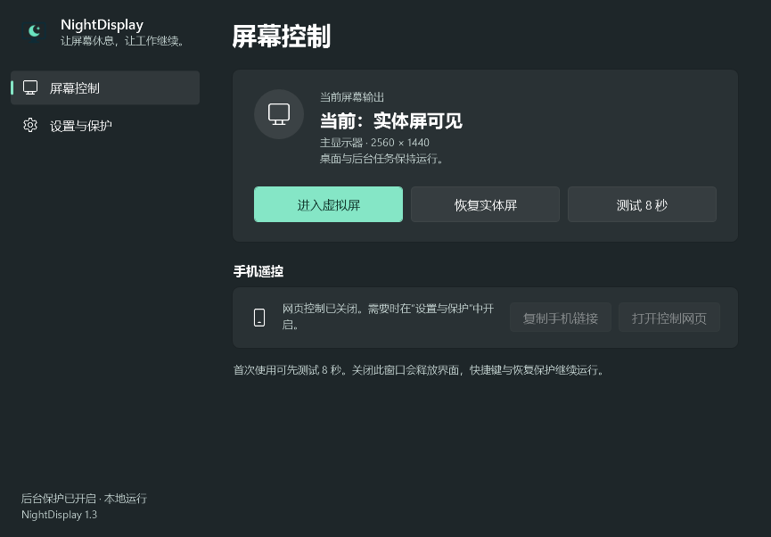

# NightDisplay

**让屏幕休息，让后台工作继续。**

`NightDisplay` 是一个轻量的 Windows 本地工具：把实体显示器临时切换到虚拟显示器，屏幕熄灭而系统、进程与远程会话继续运行。支持全局快捷键、局域网手机网页控制，并由一个独立的原生守护进程负责在异常时恢复实体屏。

<p align="center">
  
</p>

[](https://github.com/wzp100/NightDisplay/releases)
[](LICENSE)
[](#requirements)
[](https://dotnet.microsoft.com/download/dotnet-framework)
[](../../actions/workflows/ci.yml)

<sub>A quiet Windows utility that swaps your physical monitor for a virtual display, so the screen can rest while background work keeps running. Shortcuts and an optional LAN phone page control it; a tiny native guard restores the physical screen if anything goes wrong.</sub>

---

## 特性

- **瞬时切换**：在实体显示器与虚拟显示器之间切换，虚拟模式只临时应用，不改动实体屏的永久配置。
- **按需虚拟屏**：安装版在恢复实体屏后关闭自带 MttVDD 设备，使其从 Windows 显示设置中移除；再次进入时自动启用，避免干扰“扩展”和“仅第二屏”。
- **多层恢复**：主程序退出、后台心跳超时、测试倒计时到期、守护进程发现异常，任一条件都会触发恢复。
- **极轻守护**：`NightDisplay.Guard.exe` 不使用 CLR、CRT 或 STL，发布体积约 5 KiB，常驻开销可以忽略。
- **按需界面**：设置窗口是独立进程，关闭或最小化即释放；后台只保留消息窗口与原生托盘，不加载 WPF。
- **手机控制（可选）**：同一局域网内用手机网页查看状态、切换与恢复；默认关闭，打开时才监听端口。
- **无额外运行时**：基于系统自带的 .NET Framework 4.8，发布包不需要另装 .NET SDK 或 VC++ 运行库。
- **无遥测**：应用不发送任何使用数据；网页服务仅监听局域网，通信为明文 HTTP，适用于可信网络。

<p align="center">
  
</p>

## 快速开始

从 [Releases](https://github.com/wzp100/NightDisplay/releases) 选择一种方式：

| 方式 | 文件 | 说明 |
| --- | --- | --- |
| **安装版**（推荐） | `NightDisplay-1.3.1-setup-x64.exe` | 安装到 `Program Files`，创建开始菜单与可选桌面快捷方式，带卸载程序 |
| 免安装版 | `NightDisplay-1.3.1-win-x64.zip` | 解压即用，保持 `NightDisplay.exe`、`NightDisplay.Guard.exe` 与 `driver/` 同目录 |

1. 运行安装程序或解压后启动 `NightDisplay.exe`。
2. 在「设置与保护」中安装虚拟屏驱动（需要管理员授权）。安装版可在安装向导中勾选安装驱动。
   如果电脑已有可用的虚拟显示器，可以直接在列表中选择。
3. 先点击「测试 8 秒」，确认能够自动恢复，再进入虚拟屏。
4. 默认 `Ctrl + Alt + F9` 切换，`Ctrl + Alt + F10` 恢复；快捷键可在设置中更改，Windows 的 `Win + P` 仍然可用。

> 应用与安装程序均未做代码签名，Windows SmartScreen 可能提示「未知发布者」。请核对下载来源为本仓库的 Releases 页面。

> 关闭或最小化设置窗口会结束界面进程，后台只保留控制与托盘；需要再次打开时从托盘进入。
> 完全退出请使用托盘菜单中的「恢复并退出」。首次运行会启用当前用户登录启动，可在设置中关闭。

### 手机控制

网页控制默认关闭。在「设置与保护」中勾选网页控制，完成 Windows 防火墙授权后才会监听端口。
手机与电脑处于同一局域网时，打开「复制手机链接」得到的完整链接即可。

> 链接包含访问密钥，等同于控制权限，请勿公开或提交到仓库。

### 命令行

```powershell
NightDisplay.exe --restore      # 独立恢复实体屏
NightDisplay.exe --diagnose     # 显示器诊断
NightDisplay.exe --self-test    # 结构、序列化与驱动校验
```

结果写入 `%LOCALAPPDATA%\NightDisplay`。

## 恢复与边界

切换前会把实体屏配置写入 Windows 永久显示配置，虚拟输出只临时应用；恢复快照附带显示器设备路径，避免把过期枚举误用到新硬件。守护进程退出时，主程序会先恢复实体屏，再重建保护。

自带 MttVDD 驱动按需启停：先确认实体屏已恢复，再禁用对应虚拟显示设备；手动恢复、定时测试、异常恢复及完全退出共用此逻辑。禁用后仍能在应用中选择该设备，下次进入虚拟模式时重新枚举显示路径。其他软件的虚拟显卡不受此设备控制影响。若通过 Win + P 先切回实体屏，会保留当前实体屏布局并关闭本应用管理的虚拟设备。

安装到 `Program Files` 的安装版会创建两个仅按需运行的系统任务，操作固定为自带 MttVDD 设备的启用和禁用，无额外常驻进程；卸载时删除任务。旧安装首次启用此功能时需要一次管理员授权。普通权限的便携版需改用安装版；以管理员身份运行的便携版可直接启停设备。

登录启动会尝试恢复实体屏，且不会自动延续上一次虚拟输出。本版本未进行整机强制断电/重启测试，因此不能保证所有硬件在登录前都已恢复。电脑休眠、关机、锁屏或设备拔出可能影响显示操作及网络控制；没有可用实体屏时，守护进程会继续重试恢复。

虚拟模式可保持系统与虚拟桌面运行；实体模式遵循 Windows 原有电源设置。应用不调整风扇、CPU 功耗或电脑睡眠策略。

## 系统要求

- Windows 10 / 11 x64；已在 Windows 11 实机验证，Windows 10 与其他显卡组合需要进一步验证。
- 可用的实体显示器。
- 运行发布包无需安装任何运行时。

## 构建

开发需要 Visual Studio 2022 或更新版本的 C++ Build Tools，包含 MSVC x64 与 Windows SDK。

使用系统 C# 编译器与 MSVC 的本地构建（不下载 NuGet，产物位于 `artifacts/release/`）：

```powershell
./build.ps1 -Test
```

安装 .NET SDK 后也可以直接使用 solution：

```powershell
dotnet build NightDisplay.sln -c Release
```

Visual Studio 可直接打开 `NightDisplay.sln`。SDK 首次构建可能需要从 NuGet 获取 .NET Framework 参考程序集；`build.ps1` 提供无 NuGet 下载的构建路径，两种构建路径均已在 CI 中验证。

打包：

```powershell
./scripts/release.ps1            # 一条命令：构建 + 测试 + 便携版 + 安装版
./scripts/release.ps1 -SkipUpload   # 只生成本地产物，不上传
./scripts/package.ps1 -Source    # 源码包
```

`release.ps1` 依次执行 `build.ps1 -Test`、便携版打包与安装包编译，产物位于 `artifacts/`。推送到 GitHub 的 `v*` 标签（如 `v1.4.0`）时，CI 会自动执行同样的流程并把两种包发布到对应的 GitHub Release。

安装包使用 [Inno Setup 6](https://jrsoftware.org/isinfo.php) 构建，脚本位于 `installer/NightDisplay.iss`，向导支持英文与简体中文。未安装时可用 `winget install JRSoftware.InnoSetup` 获取。安装程序按用户会话启动后台进程（`runasoriginaluser`），卸载时会先恢复实体屏并退出后台，再删除文件。

打包仅纳入明确列出的源码或发布文件，排除访问密钥、本机配置、二维码、日志、快捷方式与机器诊断。

**测试**：`./build.ps1 -Test` 通过真实 TCP 连接检查授权、来源验证、请求解析、限流与会话心跳，不切换显示器、不安装驱动、不修改启动项。

## 项目结构

| 目录 | 职责 |
| --- | --- |
| `src/NightDisplay/Display` | Win32 显示模型、配置调用、可恢复切换流程 |
| `src/NightDisplay/Safety` | 原生守护启动、共享内存协议、恢复入口 |
| `src/NightDisplay/Hosting` | 无设置界面的后台、原生托盘、当前用户本地管道 |
| `src/NightDisplay/Installation` | 虚拟屏驱动安装与防火墙配置 |
| `src/NightDisplay/Networking` | 有界 TCP 服务、缓冲 HTTP 解析、固定资源与状态快照 |
| `src/NightDisplay/Storage` | 用户设置、原子恢复记录、限制大小的日志 |
| `src/NightDisplay/UI` | 按需启动的 WPF 设置界面、主题、资源与本地控制绑定 |
| `native/Guard` | 无 CLR、无 CRT 的 Win32 恢复守护 |
| `web` | 手机页面、样式、脚本；无前端依赖和构建工具 |
| `driver` | 上游签名驱动、许可证与 SHA-256 清单 |
| `tests` | 无第三方测试框架的可执行集成检查 |
| `docs` | 架构、图标设计、验证与发布说明 |

详见 [架构说明](docs/architecture.md)、[贡献指南](CONTRIBUTING.md)、[安全说明](SECURITY.md)、[更新记录](CHANGELOG.md)。

## 安全与隐私

- 网页控制默认关闭；关闭时不存在 TCP 监听器、接收任务或资源缓存。
- 仅接受私有 IPv4、链路本地或回环来源；校验 Host / Origin、访问密钥、请求大小与总读取时限。
- 完整手机链接与二维码代表控制权限，不应公开或提交到仓库。
- 这是明文 HTTP 局域网工具，不适用于公共 Wi-Fi、公网转发或多租户服务。
- 应用不发送遥测；用户配置与恢复记录位于本机 AppData。

## 许可证

本项目采用 [MIT 许可证](LICENSE)。

第三方虚拟显示器驱动来自 [VirtualDrivers/Virtual-Display-Driver](https://github.com/VirtualDrivers/Virtual-Display-Driver)，同样采用 MIT 许可证；其原始许可证文本随驱动保留于 [`driver/LICENSE.txt`](driver/LICENSE.txt)。来源、版本、校验与署名见 [第三方声明](THIRD-PARTY-NOTICES.md)。
