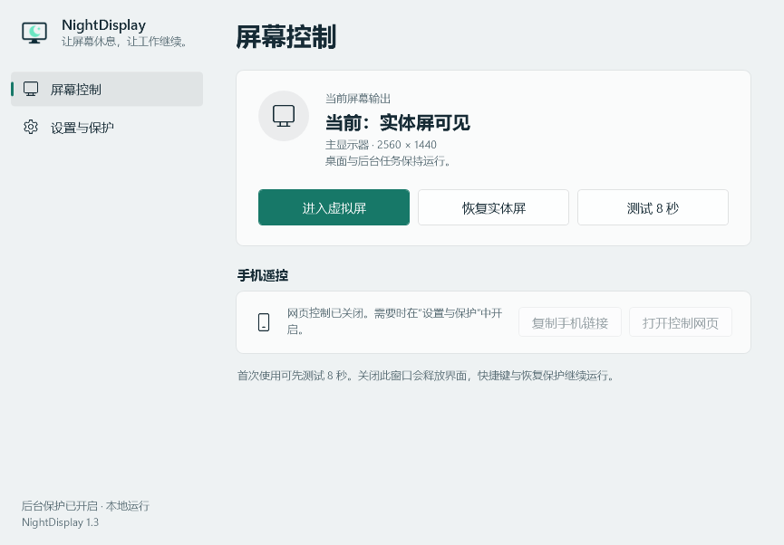

# 1.1.0 验证记录

日期：2026-10-07。环境：Windows 11 x64，AMD 集成显卡与 NVIDIA 独立显卡，双实体显示器，MTT 虚拟显示驱动。此记录代表这套硬件的实测，不能替代其他设备验证。

## 构建与集成检查

- `build.ps1 -Test`：24 项检查通过，编译器将警告作为错误。
- `dotnet build NightDisplay.sln -c Release`：0 个警告、0 个错误。
- 源码 ZIP 解压到独立目录，重新执行 `build.ps1 -Test`：24 项通过，不依赖原工作目录。
- 源码包检查：固定源码清单包含标准工程、网页、图标、驱动、文档及 CI，排除运行 EXE、本机密钥、访问二维码、快捷方式、诊断、bin/obj 与私有目录。
- 运行包检查：包含 EXE、驱动及许可证，不包含测试与预览工具、本机设置或访问密钥。

集成检查覆盖 Win32 ABI 结构长度、恢复快照序列化、私有网段边界、共享心跳、配置事件及复位、网页 UTF-8 与资源路由、密钥鉴权、Host/Origin 校验、重复请求头、分片读取、正文预读、超长正文、原子限流、不完整请求读取超时与禁止任意文件读取。检查不依赖可用显卡桌面，因此适合无显示器的 Windows CI 环境。

## 实机回归

| 检查 | 结果 |
| --- | --- |
| 虚拟屏激活与网页状态 | 1920×1080、60 Hz，仅虚拟屏输出 |
| 永久显示配置 | 虚拟期间仍仅包含实体显示器 |
| 8 秒自动恢复 | 恢复原实体显示器集合 |
| 强制结束主进程 | 独立守护恢复实体屏；重新启动后恢复状态正确 |
| 强制结束守护进程 | 主程序恢复实体屏，重新启动守护 |
| 挂起整个主进程模拟无响应 | 共享心跳超时后守护独立恢复；主进程恢复执行后状态正常 |
| 手机页面操作 | 浏览器点击测试按钮可切换并自动恢复，按钮状态与输出一致 |
| 手机布局 | 390×844 和 320 像素宽度，无横向溢出 |
| 全局快捷键 | 两个快捷键注册成功；本轮未注入真实键盘按键 |
| 自检 | 显示配置验证与驱动 SHA-256 校验通过 |

没有进行整机强制断电/重启、Windows 10、实体手机无线网络或其他显卡组合测试。GitHub CI 文件已准备，本地两种构建路径均通过；尚未在远程仓库运行 CI。

## 资源采样

实体模式、窗口隐藏、没有打开的手机页面，采样 15 秒。各进程资源如下：

| 指标 | 旧主进程 | 新主进程 | 旧守护 | 新守护 |
| --- | ---: | ---: | ---: | ---: |
| 工作集 MiB | 76.90 | 49.00 | 33.67 | 29.41 |
| 私有内存 MiB | 37.39 | 26.81 | 27.39 | 23.00 |
| CPU 时间增量，秒 | 0.0156 | 0.0000 | 0.0312 | 0.0156 |
| 句柄数 | 833 | 390 | 279 | 292 |

本次样本工作集合计 110.57 → 78.41 MiB；私有内存合计 64.78 → 49.81 MiB。新版本两个进程在 15 秒内的 Read/WriteOperations 增量均为 0，旧版心跳文件的修改时间也保持不变。共享内存心跳持续工作，实体模式守护阻塞等待事件。

这是单次、不同进程运行时长下的本机采样，工作集受 GC、系统缓存和使用历史影响，不能将比例视为稳定性能承诺。虚拟状态会按需检查显示配置，手机访问会产生网络 I/O，切换、故障与日志仍会写磁盘。应用不控制风扇噪声。

## 界面预览

桌面静态布局示例（使用示例显示器名称，不执行屏幕控制）：

